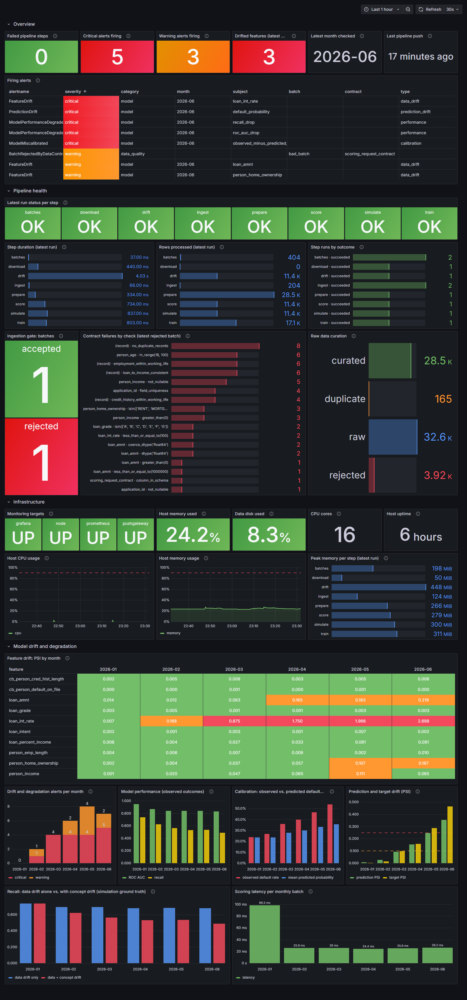

# Credit Scoring Observability

Sustainment and reliability layer for a credit scoring model in production: data contracts that
block bad data, drift simulation and detection, pipeline observability and LGPD governance.

FIAP MLET Tech Challenge, Phase 4.

## Quick start

Requires [uv](https://docs.astral.sh/uv/) and Python 3.12. No Kaggle account is needed.

```bash
make install   # create the virtual environment
make stage1    # download, curate, split, train, then run the good and bad demo batches
make stage2    # simulate six production months, score them, detect drift (needs stage1)
make monitor-up  # start the Prometheus + Grafana monitoring stack (needs Docker)
make stage4    # fairness audit of the model's decisions by age group (needs stage2)
make stage3    # export pipeline, drift and model metrics and push them to the stack
make pipeline  # stage1 + stage2 + stage4 + stage3, no Docker needed (the metrics push is skipped with a warning)
make all       # monitor-up + pipeline: every stage plus the live dashboard
make test      # contract, ingestion, simulation, drift detection, observability and fairness tests
make clean     # delete everything generated (data, model, logs, reports) to start from scratch
```

`make stage1` ends with `Error 1` from `validate-bad`. That is the contract rejecting the bad batch,
which is the expected result.

## Dataset

[Credit Risk Dataset](https://www.kaggle.com/datasets/laotse/credit-risk-dataset) (Kaggle): 32,581
loan applications with a binary target `loan_status` (1 = loan in default, 21.8% positive rate).

| Column | Meaning |
| --- | --- |
| `person_age`, `person_income`, `person_emp_length`, `person_home_ownership` | Applicant profile |
| `loan_intent`, `loan_grade`, `loan_amnt`, `loan_int_rate`, `loan_percent_income` | Loan terms |
| `cb_person_default_on_file`, `cb_person_cred_hist_length` | Credit bureau history |

The source of this dataset is not well documented, and it is widely believed to be at least partly
simulated. It was chosen because its columns map directly onto the economic scenario: income,
interest rates, loan-to-income and employment are what inflation and unemployment move. It also
contains real defects for the contract to catch.

`make data` downloads the file anonymously with `kagglehub` and verifies its SHA-256 checksum. Raw
data is not committed. Only a 500-row sample of the curated reference data lives in `data/sample/`
for the tests.

Preparation (`credit_scoring.data.prepare`):

1. drops exact duplicate rows
2. assigns each application an opaque surrogate key (`application_id`)
3. runs the raw data through the labeled data contract and removes every row that breaks it
4. re-validates the curated data, then splits it with a fixed seed, stratified by target, into two
   physically separate files:

| Dataset | Path | Rows | Purpose |
| --- | --- | --- | --- |
| Reference | `data/reference/reference.parquet` | 17,097 | Model training and the drift baseline |
| Production base | `data/production/production_base.parquet` | 11,398 | Never used for training. Source of incoming batches and of the drifted production data |

## Stage 1: data contracts

Contracts are written with [Pandera](https://pandera.readthedocs.io/) in
`src/credit_scoring/contracts/credit_contract.py`:

- `scoring_request_contract`: an incoming scoring batch (features plus `application_id`)
- `labeled_credit_contract`: the same rules plus the target, used for raw curation and training

| # | Rule | Columns |
| --- | --- | --- |
| 1 | Exact schema: no unexpected columns (e.g. a leaked `national_id`) and no missing ones | all |
| 2 | No nulls | all |
| 3 | Values must have the declared type. Text in a numeric column is rejected | all |
| 4 | Unique, non-empty application identifier | `application_id` |
| 5 | No duplicate records (the same application replayed under a new id) | all except `application_id` |
| 6 | Age between 18 and 100 | `person_age` |
| 7 | Income > 0 and ≤ 10,000,000 | `person_income` |
| 8 | Loan amount > 0 and ≤ 1,000,000. Interest rate > 0 and ≤ 100% | `loan_amnt`, `loan_int_rate` |
| 9 | Employment and credit-history years in [0, 86] | `person_emp_length`, `cb_person_cred_hist_length` |
| 10 | Employment and credit history cannot be longer than the applicant's working life (age − 14) | cross-field |
| 11 | `loan_percent_income` within ±0.10 of `loan_amnt / person_income` | cross-field |
| 12 | Category values from a closed list | `person_home_ownership`, `loan_intent`, `loan_grade`, `cb_person_default_on_file` |
| 13 | Target is 0 (repaid) or 1 (default) | `loan_status` (labeled contract only) |

The bounds are sanity limits, not the ranges seen in the reference data. The contract blocks data
that cannot be valid. It does not block legitimate shifts in the population, which are drift and are
handled in Stage 2.

### The contract on real data

On the raw dataset (`reports/validation/raw_curation_report.json`), 165 exact duplicates are removed
first. The contract then rejects 3,921 applications:

| Defect | Rows |
| --- | --- |
| Missing interest rate | 3,095 |
| Missing employment length | 887 |
| Impossible ages (123, 144) | 5 |
| Employment length of 123 years | 2 |
| Employment longer than working life | 2 |

Some rows have more than one defect. 28,495 clean applications remain.

Every removed row is traceable:

| File | Content | Committed |
| --- | --- | --- |
| `reports/validation/raw_curation_report.json` | Row counts and failures per rule | yes |
| `reports/validation/raw_curation_failure_cases.csv` | One line per failure: `application_id`, column, rule and the offending value | yes |
| `data/quarantine/raw_rejected_rows.csv` | The removed rows as they were, plus a `broken_rules` column | no (derived from raw data, rebuilt by `make data`) |

### Ingestion gate

```bash
uv run python -m credit_scoring.ingest <batch.csv|batch.parquet> [--contract scoring|labeled]
```

The gate validates the whole batch lazily, so every violation is collected in one run:

- **Accepted:** the batch is written to `data/validated/`. Exit code 0.
- **Rejected:** nothing reaches `data/validated/`. The batch is copied to `data/quarantine/`, a
  report is written to `reports/validation/` (`<batch>_rejection.json` with failures per rule, and
  `<batch>_failure_cases.csv` with one line per failure, keyed by `application_id`), a
  `batch_rejected` event is logged and the exit code is **1**.

`make batches` builds two seeded demo batches from the production base: a clean 200-row
`good_batch.csv` and a `bad_batch.csv` with these injected anomalies:

| Anomaly | Count | Caught by |
| --- | --- | --- |
| Null income | 5 | `not_nullable` |
| Negative income | 3 | `greater_than(0)` |
| Under-age (16) and impossible (144) ages | 4 + 2 | `in_range(18, 100)` |
| Unknown home ownership / loan grade | 3 + 2 | `isin([...])` |
| Interest rate of 250% | 2 | `less_than_or_equal_to(100)` |
| Text in a numeric column (`"unknown"` loan amount) | 2 | `coerce_dtype('float64')` |
| Employment longer than working life | 3 | `employment_within_working_life` |
| Loan-to-income ratio inconsistent with amount and income | 3 | `loan_to_income_consistent` |
| Null application id | 1 | `not_nullable` |
| Reused application id | 2 | `field_uniqueness` |
| Application replayed under a new id | 4 | `no_duplicate_records` |
| Unexpected PII column `national_id` | 1 | `column_in_schema` |

A single bad value can break more than one rule. For example, a 16-year-old applicant also fails
the working-life checks. So the rejection report shows more failures than anomalies injected.

```bash
make validate-good   # exit 0, batch accepted
make validate-bad    # exit 1, batch rejected and quarantined
```

### Baseline model

`credit_scoring.model.train` re-validates the reference data against the labeled contract, then
trains a scikit-learn pipeline on a seeded, stratified 75/25 split of the reference data. The
pipeline is an ordinal encoder with a fixed category list, feeding a `HistGradientBoostingClassifier`
with default settings. The model is a means, not the deliverable, so it is not tuned.

`person_age` is a protected attribute and is excluded from the features (see
[bias mitigation](#bias-mitigation)). It is still validated, because the contract enforces the legal
minimum age.

Holdout metrics (`reports/model/model_card.json`): ROC AUC 0.936, average precision 0.882,
accuracy 0.930, recall 0.710 at a 0.5 threshold.

Permutation importance (`reports/model/feature_importance.csv`):

| Feature | Importance (ROC AUC drop) |
| --- | --- |
| `loan_percent_income` | 0.099 |
| `person_home_ownership` | 0.081 |
| `person_income` | 0.070 |
| `loan_grade` | 0.055 |
| `loan_intent` | 0.042 |
| `loan_int_rate` | 0.021 |

Income, loan-to-income and interest rate are the features an inflationary shock moves, which makes
them the drift targets for Stage 2.

### Logs

Every step writes structured JSON lines with `stage`, `run_id` and an `event` name to
`logs/pipeline.jsonl` and to stderr. These logs are the input for Stage 3 observability.

## Stage 2: drift simulation and detection

```bash
make stage2   # simulate -> score -> drift
```

### Scenario

The production base is split, seeded and without overlap, into six monthly batches of about 1,900
applications (2026-01 to 2026-06). An economic crisis builds up over these months. Its strength
(severity) goes 0, 0.2, 0.4, 0.6, 0.8, 1.0. **January has severity 0 and is the control month.** It
is the untouched production base, so any drift reported for it would be a false alarm.

Each month gets the same three changes, in this order, scaled by its severity. The values below are
at full severity (June). The settings are in `src/credit_scoring/drift/scenario.py`, and the
simulation is `credit_scoring.drift.simulate`.

**1. Real changes in the population (data drift the model understands).**

| Change | Feature(s) |
| --- | --- |
| Interest rate + 4.0 pp (central bank rate hike) | `loan_int_rate` |
| 40% of applicants are a new profile: income × U(0.5, 0.8), home ownership `RENT` | `person_income`, `person_home_ownership`, `loan_percent_income` |

These applicants really are riskier. Their outcomes are resampled from the reference risk of the
changed row, using the baseline model's probability as the stand-in for that risk. The model was
trained on this kind of relationship, so it reads these applicants correctly.

**2. Nominal inflation (data drift the model misreads).** Prices and wages rise 40%: income and loan
amount × 1.4. People are not actually richer, so their outcomes do not change. The model learned
risk from pre-inflation money values. It sees higher incomes, reads them as safer and underestimates
risk. Loan-to-income does not change, because both sides inflate.

**3. Concept drift (P(y | X) changes).** Inflation eats into real disposable income, which none of
the features measure. A repaid loan becomes a default with probability `0.9 × severity × stress`.
`stress` rises linearly with `loan_percent_income` from 0.05 to 0.35 and is weighted by housing
exposure: renters 1.0, mortgage 0.5, owners 0.25. Applicants with the same features now default more
than they did in the reference data.

Changes 1 and 2 move the input distribution (data drift). Inflation also changes what a given income
means, which is why it can mislead the model. Change 3 leaves the inputs alone and changes only the
outcomes.

Every monthly batch passes the labeled data contract (`make stage2` fails otherwise). The crisis is a
legitimate change in the population, not bad data. During development the contract did catch a
simulator bug: a `loan_percent_income` that no longer matched amount ÷ income.

To measure each kind of drift separately, the simulator also stores each application's outcome
**without** concept drift (after changes 1 and 2 only) in
`data/simulation/concept_drift_ground_truth.parquet`. A real lender would never have this.
`reports/drift/simulation_manifest.json` records what was injected:

| Month | Severity | Rows | Default rate | Without concept drift | Concept-drift defaults | New profiles |
| --- | --- | --- | --- | --- | --- | --- |
| 2026-01 | 0.0 | 1,900 | 23.9% | 23.9% | 0 | 0.0% |
| 2026-02 | 0.2 | 1,900 | 26.8% | 23.7% | 60 | 7.7% |
| 2026-03 | 0.4 | 1,900 | 35.7% | 29.0% | 128 | 18.6% |
| 2026-04 | 0.6 | 1,900 | 39.8% | 31.1% | 167 | 23.5% |
| 2026-05 | 0.8 | 1,899 | 46.7% | 36.1% | 200 | 33.1% |
| 2026-06 | 1.0 | 1,899 | 53.9% | 37.7% | 308 | 40.8% |

The reference default rate is 21.8%.

**Time is compressed.** In real lending, a loan's outcome is known only months after it is granted.
Here every month is written with its outcomes already known, so the detection step looks back after
those outcomes have arrived. Checks that need outcomes (performance, calibration) would lag that much
in a real deployment. Checks on inputs and predictions would not.

### Predictions

`credit_scoring.model.score` sends each month's applications (without the label) through the
scoring contract. It writes `application_id`, `default_probability` and `predicted_default`
(threshold 0.5) to `data/production/predictions/<month>.parquet`, and logs volume, latency and the
predicted default rate.

### Detection

`credit_scoring.drift.detect` checks each month against the reference data with **Evidently**
(`DataDriftPreset`, `ValueDrift`, `ClassificationPreset`) and with scipy tests:

| Check | Needs outcomes? | Compared | Method | Alert when |
| --- | --- | --- | --- | --- |
| Feature drift | no | Reference dataset (17,097 rows) vs. month | PSI on reference decile bins (categories for categorical features) | PSI ≥ 0.10 (warning), ≥ 0.25 (critical) |
| Statistical significance | no | same | Kolmogorov–Smirnov (numeric), chi-square (categorical), Bonferroni-corrected α = 0.05 / 10 | Reported, no alert |
| Prediction drift | no | Reference holdout scores vs. month scores | PSI of `default_probability` | PSI ≥ 0.10 |
| Performance | yes | Reference holdout vs. month | ROC AUC and recall at 0.5 | AUC drop ≥ 0.05, recall drop ≥ 0.10 |
| Calibration | yes | Month | Observed default rate − mean predicted probability | gap ≥ 5 pp |

Why these choices:

- **PSI uses quantile bins.** Evidently's built-in `psi` uses equal-width bins. Income is heavily
  right-skewed, so almost every applicant lands in one bin, and the built-in test missed a large
  income shift. Credit scoring normally bins PSI on reference deciles. That version is in
  `drift/statistics.py` and is registered as an Evidently stat test (`quantile_psi`), so the HTML
  reports and the CSV tables show the same statistic.
- **Two verdicts: material and significant.** PSI measures the size of a shift and drives the
  alerts. KS and chi-square say whether a shift is statistically real. With about 1,900 rows a
  month they also flag shifts too small to matter, so they are reported but raise no alert.
- **Evidently's pass/fail checks use the same thresholds as the alerts.** The data drift report
  marks the whole dataset as drifted when at least 10% of the features (1 of 10) drift. Evidently's
  default needs 50%, which in June reported "no dataset drift" while 3 features had drifted. In the
  model health report, the ROC AUC and recall checks fail at the same drops that raise alerts
  (0.05 and 0.10). Evidently's default ±20% tolerance had passed June's AUC of 0.83.
- **Calibration catches what the inputs cannot show.** Concept drift does not change the inputs,
  so only outcome-based checks see it. A model whose predicted default rate falls below the observed
  rate no longer reflects reality.

### Results

**Which features drifted.** PSI by month (`reports/drift/feature_drift_by_month.csv`). Bold marks
drift (PSI ≥ 0.10):

| Month | `loan_int_rate` | `loan_amnt` | `person_home_ownership` | `person_income` | `loan_percent_income` | Highest of the 5 untouched |
| --- | --- | --- | --- | --- | --- | --- |
| 2026-01 | 0.007 | 0.014 | 0.002 | 0.001 | 0.008 | 0.004 |
| 2026-02 | **0.168** | 0.012 | 0.004 | 0.020 | 0.004 | 0.006 |
| 2026-03 | **0.875** | 0.063 | 0.037 | 0.047 | 0.027 | 0.007 |
| 2026-04 | **1.750** | **0.165** | 0.057 | 0.065 | 0.033 | 0.009 |
| 2026-05 | **1.966** | **0.163** | **0.107** | **0.111** | 0.081 | 0.007 |
| 2026-06 | **2.698** | **0.219** | **0.187** | 0.085 | 0.081 | 0.010 |

- **No false alarms.** No feature passes PSI 0.10 in January. The five untouched features stay
  below 0.011 in every month and are never significant (lowest p = 0.03, above the corrected 0.005).
- **The rate hike is caught first:** PSI 0.17 in February, at 20% severity.
- **The statistical tests find every injected feature.** From March on they flag exactly the five
  injected features (p < 1e-5) and nothing else.
- **PSI flags three of the five in June, and four in May.** `person_income` and
  `loan_percent_income` move less than expected, because the changes partly cancel out: inflation
  raises incomes while the new profiles lower them, and inflation leaves loan-to-income unchanged.
  Their shift is statistically clear but small. This is why the statistical tests are reported next
  to PSI.

**How much each kind of drift hurts the model.** `reports/drift/model_health_by_month.csv`. The
reference holdout scored ROC AUC 0.936 and recall 0.710:

| Month | AUC, data drift only | Recall, data drift only | AUC, with concept drift | Recall, with concept drift | Observed default rate | Mean predicted | Gap |
| --- | --- | --- | --- | --- | --- | --- | --- |
| 2026-01 | 0.948 | 0.738 | 0.948 | 0.738 | 23.9% | 23.5% | +0.4 pp |
| 2026-02 | 0.905 | 0.696 | 0.869 | 0.624 | 26.8% | 23.5% | +3.3 pp |
| 2026-03 | 0.915 | 0.693 | 0.838 | 0.564 | 35.7% | 27.9% | +7.9 pp |
| 2026-04 | 0.910 | 0.680 | 0.840 | 0.531 | 39.8% | 30.0% | +9.9 pp |
| 2026-05 | 0.908 | 0.682 | 0.842 | 0.536 | 46.7% | 33.2% | +13.5 pp |
| 2026-06 | 0.910 | 0.679 | 0.829 | 0.486 | 53.9% | 35.6% | +18.3 pp |

- **Data drift alone does moderate damage.** Inflation makes applicants look richer than they are,
  so AUC drops from 0.95 to about 0.91 and recall from 0.74 to 0.68. The damage appears as soon as
  inflation starts and then levels off. It stays limited because the model's most important
  feature, loan-to-income, is not affected by inflation.
- **Concept drift does severe damage on top.** In June recall is 0.49: half of the loans that
  default were approved. The model predicts a 35.6% default rate against 53.9% in reality, an
  18 pp underestimate.
- **Input checks warn early. Outcome checks confirm the damage.** Feature and prediction drift
  checks run as applications arrive. They fired first on the rate hike (February) and then on loan
  amount, prediction scores, home ownership and income. Only the performance and calibration checks,
  which need outcomes, show how badly the model is failing, and only they can see the concept drift.

### Alerts

`reports/drift/alerts.json` lists each alert with month, type, subject, value, threshold and
severity. Each alert is also logged as a `drift_alert` event in `logs/pipeline.jsonl` for Stage 3.

| Month | Alerts | What fired |
| --- | --- | --- |
| 2026-01 | 0 | none (control) |
| 2026-02 | 2 | `loan_int_rate` drift, AUC drop |
| 2026-03 | 4 | rate drift, AUC drop, recall drop, calibration (+7.9 pp) |
| 2026-04 | 6 | + `loan_amnt` drift, prediction drift |
| 2026-05 | 8 | + `person_home_ownership` and `person_income` drift |
| 2026-06 | 7 | rate, loan amount and home ownership drift, prediction drift, AUC drop, recall drop, calibration (+18.3 pp) |

### Outputs

| File | Content |
| --- | --- |
| `reports/drift/evidently/data_drift_<month>.html` | Evidently feature and target drift report, for the control month (2026-01) and the latest month (2026-06) |
| `reports/drift/evidently/model_health_<month>.html` | Evidently prediction drift and classification performance against the reference holdout |
| `reports/drift/feature_drift_by_month.csv` | PSI, band, KS / chi-square statistic and p-value, and both verdicts, per feature per month |
| `reports/drift/model_health_by_month.csv` | Performance, calibration and prediction drift per month, with and without concept drift |
| `reports/drift/alerts.json` | Every alert raised |
| `reports/drift/drift_summary.json` | Baseline, features drifted in the latest month, alerts per month, injected vs. detected |
| `reports/drift/simulation_manifest.json` | What the simulator injected, month by month |

The CSV and JSON outputs are byte-for-byte reproducible. The Evidently HTML files embed random
element ids, so a rerun changes the files but not what they show.

Evidently 0.7 does not work with pandas 3, so pandas is pinned to `<3`.

## Stage 3: pipeline and model observability

```bash
make monitor-up   # start Pushgateway, Prometheus, node-exporter and Grafana (needs Docker)
make stage3       # turn logs and drift results into metrics and push them (needs stage1 and stage2)
```

Then open the dashboard at http://localhost:3000 (anonymous read-only access, no login). Prometheus
is at http://localhost:9090 and `make monitor-down` stops the stack. Everything is open source and
runs locally.



### Architecture

```
pipeline steps ──> logs/pipeline.jsonl ─┐
                                        ├─> observability.export ──> reports/monitoring/metrics.prom
Stage 2 drift outputs (reports/drift) ──┘            │
                                                     └─> Pushgateway ──> Prometheus ──> Grafana
                                     node-exporter (host) ──┘   (alert rules)
```

1. **Every pipeline step is tracked.** `observability/step.py` wraps each step (`download`,
   `prepare`, `train`, `batches`, `ingest`, `simulate`, `score`, `drift`). One run gets one
   `run_id`, which every log line of that run carries. The step writes `step_started`, then
   `step_succeeded` or `step_failed` with its wall-clock time, CPU time, peak memory and, on
   failure, the error.
2. **Logs and drift results come together in one place.** `credit_scoring.observability.export`
   reads the structured log and the Stage 2 outputs (`feature_drift_by_month.csv`,
   `model_health_by_month.csv`, `alerts.json`, `drift_summary.json`) and builds a single set of
   Prometheus metrics. It always writes them to `reports/monitoring/metrics.prom`, so the evidence
   exists even without Docker.
3. **Prometheus collects them.** The pipeline runs as batch jobs, which end before Prometheus can
   scrape them, so the exporter pushes to a **Pushgateway** that Prometheus scrapes.
   **node-exporter** adds host metrics, and Prometheus also scrapes every component of the stack
   to check that it is up.
4. **Prometheus evaluates the alert rules** in `monitoring/prometheus/rules.yml`, and **Grafana**
   shows the provisioned dashboard `monitoring/grafana/dashboards/credit-scoring.json`.

If the Pushgateway cannot be reached, the export logs `metrics_push_failed` and still writes the
snapshot file. Use `uv run python -m credit_scoring.observability.export --no-push` to only write
the file.

### Metrics

All metrics use the `credit_` prefix. Pipeline metrics are labeled by `step`, and drift and model
metrics by production `month`.

**Pipeline health**

| Metric | Meaning | Why it matters |
| --- | --- | --- |
| `credit_pipeline_step_runs_total{step, status}` | Executions per step, `succeeded` or `failed` | Execution status and failure count |
| `credit_pipeline_step_last_success{step}` | 1 if the latest run succeeded, 0 if it failed | Current status of each step, drives `PipelineStepFailed` |
| `credit_pipeline_step_last_duration_seconds{step}` | Wall-clock duration of the latest run | Latency, spots slow steps |
| `credit_pipeline_step_last_rows_processed{step}` | Rows reported by the latest run | Volume of data processed |
| `credit_pipeline_step_last_timestamp_seconds{step}` | When the latest run finished | Freshness |
| `credit_ingest_batches_total{outcome}` / `credit_ingest_rows_total{outcome}` | Batches and rows `accepted` or `rejected` by the data contract | Ingestion success and failure |
| `credit_contract_check_failures{batch, contract, column, check}` | Failure cases per Pandera check in the latest rejected batch | Which rules bad data breaks, drives `BatchRejectedByDataContract` |
| `credit_curation_rows{outcome}` | Raw, duplicate, rejected and curated rows of the raw dataset | Transformation volume and data loss |
| `credit_scoring_batch_latency_seconds{month}` | Time to validate and score a monthly batch | Scoring latency |

**Infrastructure stability**

| Metric | Meaning | Why it matters |
| --- | --- | --- |
| `up{job}` | Whether Prometheus can scrape Pushgateway, node-exporter, Prometheus and Grafana | Stack availability, drives `MonitoringTargetDown` |
| `node_cpu_seconds_total`, `node_memory_*`, `node_filesystem_*` | Host CPU, memory and disk (node-exporter) | Host saturation |
| `credit_pipeline_step_last_cpu_seconds{step}` / `credit_pipeline_step_last_peak_memory_bytes{step}` | CPU time and peak memory of each step's process | Resource cost per step |
| `push_time_seconds{job="credit_scoring_pipeline"}` | When the pipeline last pushed its metrics | Detects a pipeline that stopped reporting |

**Drift and model degradation**

| Metric | Meaning | Why it matters |
| --- | --- | --- |
| `credit_feature_psi{month, feature}` | PSI of each feature against the reference dataset | Size of each feature's shift |
| `credit_feature_drift_p_value{month, feature, test}` | KS or chi-square p-value | Statistical significance of the shift |
| `credit_feature_drifted{month, feature}` / `credit_drifted_features{month}` | Whether a feature crossed PSI 0.10, and how many did | Drifted features per month |
| `credit_prediction_psi{month}` / `credit_target_psi{month}` | PSI of the predicted probability and of the observed label | Prediction drift and target drift |
| `credit_model_{roc_auc,recall,precision,brier_score}{month, ground_truth}` | Performance per month | Model degradation |
| `credit_model_{observed_default_rate,mean_default_probability,predicted_default_rate}{month, ground_truth}` | Observed vs. predicted default rate | Calibration, the only signal for concept drift |
| `credit_model_baseline{metric}` | The same metrics on the reference holdout | What "degraded" is measured against |
| `credit_drift_alert_value` / `credit_drift_alert_threshold{month, type, subject, severity}` | Each Stage 2 alert with its value and threshold | Feeds the Prometheus drift alerts |
| `credit_production_scored_rows{month}` | Applications scored per month | Production volume |

The model metrics have a `ground_truth` label. `observed` is what a lender would see.
`simulated_without_concept_drift` uses the outcomes the simulator stored before injecting concept
drift. It exists only in this simulation and separates the damage of each kind of drift.

### Alerts

Alerts are Prometheus alerting rules. Each one fires when a threshold is crossed and shows up in
Prometheus, in the dashboard's counters and in its "Firing alerts" table. Drift alerts reuse the
Stage 2 thresholds and look only at the latest production month, so they describe the model's
current state.

| Alert | Category | Severity | Fires when |
| --- | --- | --- | --- |
| `PipelineStepFailed` | pipeline | critical | A step's latest run failed |
| `BatchRejectedByDataContract` | data quality | warning | The latest rejected batch has contract failures (it was blocked and quarantined) |
| `PipelineMetricsStale` | pipeline | warning | No metrics pushed for more than 24 hours |
| `FeatureDrift` | model | warning at PSI ≥ 0.10, critical at ≥ 0.25 | A feature drifted in the latest month |
| `PredictionDrift` | model | warning at PSI ≥ 0.10, critical at ≥ 0.25 | The predicted default probability drifted |
| `ModelPerformanceDegraded` | model | critical | ROC AUC dropped ≥ 0.05 or recall dropped ≥ 0.10 against the reference holdout |
| `ModelMiscalibrated` | model | critical | The observed default rate exceeds the predicted rate by ≥ 5 pp |
| `MonitoringTargetDown` | infrastructure | critical | A component of the stack is not responding for 1 minute |
| `HostHighCpuUsage` / `HostHighMemoryUsage` / `HostDiskAlmostFull` | infrastructure | warning | Usage above 90% for 5 minutes |

After `make all`, Prometheus fires 8 alerts. Pipeline and infrastructure are
healthy, while data quality and the model are not:

| Alert | Severity | Subject |
| --- | --- | --- |
| `BatchRejectedByDataContract` | warning | `bad_batch` blocked by `scoring_request_contract` |
| `FeatureDrift` | critical | `loan_int_rate` (PSI 2.70) |
| `FeatureDrift` | warning | `loan_amnt` (PSI 0.22), `person_home_ownership` (PSI 0.19) |
| `PredictionDrift` | critical | `default_probability` |
| `ModelPerformanceDegraded` | critical | ROC AUC drop, recall drop |
| `ModelMiscalibrated` | critical | observed default rate 18.3 pp above predicted |

The ingestion step itself shows as succeeded when it rejects the bad batch. The gate did its job,
and the rejection is reported by the ingestion metrics and `BatchRejectedByDataContract`, not as a
pipeline failure.

### Dashboard

The **Credit Scoring Observability** dashboard has four sections, and each panel has a description:

| Section | Shows |
| --- | --- |
| Overview | Failed steps, critical and warning alerts firing, drifted features, latest month checked, last push, table of firing alerts |
| Pipeline health | Latest status, duration, rows and run count per step; ingestion gate results; contract failures per check; raw data curation |
| Infrastructure | Stack targets up, host CPU, memory, disk and uptime, peak memory per step |
| Model drift and degradation | PSI heatmap by feature and month, alerts per month, ROC AUC and recall, calibration, prediction and target drift, recall with and without concept drift, scoring latency |

## Stage 4: governance, LGPD and causality

```bash
make stage4   # fairness audit by age group, on the reference holdout and every production month
```

This section is the project's data protection plan under the LGPD (Lei 13.709/2018). It covers how
personal data is handled, the legal basis for the credit decision, the retention plan, bias
mitigation, a causal analysis of the degradation, and what to do when an alert fires. Where a
measure is implemented, the code and the evidence are named. Where it is a recommendation for a
real deployment, it says so.

Roles, as they would be in a real lender: the fintech is the **controller** (*controlador*, Art. 5,
VI). A credit bureau that supplies `cb_person_*` data is a separate controller. A cloud host for the
pipeline would be a **processor** (*operador*). A **DPO** (*encarregado*, Art. 41) is the contact
point for applicants and for the ANPD.

### Personal data inventory

The dataset has no direct identifiers: no name, CPF, address or phone number. It is still personal
data. LGPD covers data about an *identifiable* person (Art. 5, I), and age, income, employment length
and loan amount together can single out an applicant. So every column is treated as personal data.

| Column(s) | Class | Use in this project |
| --- | --- | --- |
| `application_id` | Pseudonymous identifier | Joins applications, predictions and failure reports. Carries no information about the person |
| `person_age` | Personal data, **protected attribute** (discrimination risk) | Contract check of the legal minimum age (18) and the fairness audit. **Not a model feature** |
| `person_income`, `person_emp_length`, `person_home_ownership` | Personal, financial | Model features |
| `loan_amnt`, `loan_int_rate`, `loan_percent_income`, `loan_grade` | Personal, financial (loan terms) | Model features |
| `loan_intent` | Personal. The value `MEDICAL` reveals a health situation, which is **sensitive data** (Art. 5, II) | Model feature. See the open risk below |
| `cb_person_default_on_file`, `cb_person_cred_hist_length` | Credit bureau data (Lei 12.414/2011, Cadastro Positivo) | Model features |
| `loan_status` | Personal, outcome of the credit relationship | Training target and monitoring |
| `national_id` (demo only) | Direct identifier | Never accepted. Injected into `bad_batch.csv` to show the contract blocking it |

### How personal data is handled (privacy by design and by default)

| Measure | LGPD principle | How it is implemented |
| --- | --- | --- |
| **Minimization by contract** | Necessity (Art. 6, III) | The data contract uses an exact schema (rule 1). A batch with any extra column, such as a leaked `national_id`, is rejected as a whole. Nothing reaches `data/validated/`. Collecting more than the model needs fails the pipeline by default |
| **Pseudonymization** | Security (Art. 6, VII), Art. 13 | Rows get an opaque `application_id` (truncated SHA-256 of seed and row number), unrelated to any personal attribute. Failure reports, predictions and logs refer to applications only by this id |
| **Protected attribute kept out of the model** | Non-discrimination (Art. 6, IX) | `person_age` is in `PROTECTED_ATTRIBUTES` (`config.py`) and excluded from `MODEL_FEATURES`. The model card records the exclusion. Age is used only to enforce the legal minimum age and to audit fairness |
| **Purpose limitation** | Purpose (Art. 6, I) | Training uses only the reference dataset. Production data is used for scoring and monitoring and never for training. The two live in separate files |
| **Aggregated observability** | Necessity, security | Logs hold counts, rates, paths, run ids and pseudonymous ids, never feature values. Prometheus metrics and the Grafana dashboard are aggregated by step, month and feature. Evidently reports show distributions, not applicants |
| **Least exposure of rejected data** | Security, prevention (Art. 6, VIII) | Rejection reports record the broken rule and the column. For the leaked `national_id`, only the column name is recorded (`reports/validation/bad_batch_failure_cases.csv`). The values exist only in the git-ignored quarantine copy |
| **No personal data in version control** | Security | `data/*` is git-ignored. Only a 500-row sample of the public, already pseudonymized reference dataset is committed for the tests |
| **No international transfer** | Art. 33 | The whole stack (pipeline, Pushgateway, Prometheus, Grafana) runs locally in Docker. No SaaS receives data |
| **Integrity of the source** | Data quality (Art. 6, V) | The raw file's SHA-256 is verified on download. The contract rejects impossible values, so wrong data about a person does not drive a decision |
| **Traceability** | Accountability (Art. 6, X) | Every step has a `run_id`. Every rejected row is listed with the rule it broke. Every alert is in `reports/drift/alerts.json` and the log |

**Needed before production (not implemented in this project):**

- **Real tokenization.** The surrogate id here is derived from the row number. In production it
  should be a random token issued by a vault that keeps the token → CPF mapping, with restricted
  access and keys stored apart from the data.
- **Access control.** Grafana allows anonymous read-only access so the demo needs no login. In
  production: SSO, role-based access and an audit log. Quarantine is the most sensitive area (raw
  rows as received) and should be restricted to data engineering.
- **Encryption** at rest for `data/` and the Prometheus volume, and TLS between components.
- **RIPD.** A data protection impact assessment (*Relatório de Impacto*, Art. 38) for the scoring
  model, because it makes automated decisions about people with financial data. Also a record of
  processing activities (Art. 37) and an incident response plan with notification to the ANPD and
  the data subjects (Art. 48).
- **Open risk: `loan_intent = MEDICAL`.** Health data is sensitive (Art. 11), and *proteção do
  crédito* is not one of the legal bases Art. 11 allows for sensitive data. Options: replace the
  category with a neutral one (e.g. `PERSONAL`), collect it only with specific, separate consent
  (Art. 11, I), or drop it after measuring the impact (it is the 5th most important feature, with
  0.042 AUC). This project keeps the column because it is part of the public dataset, but it should
  be resolved before real use.

### Legal basis for the credit decision

| Processing | Legal basis | Why |
| --- | --- | --- |
| Scoring an application and deciding on it | **Art. 7, X — protection of credit** (*proteção do crédito*) | The basis written for credit analysis. It does not depend on consent |
| Using the applicant's data to evaluate and grant the loan they requested | Art. 7, V — preliminary steps to a contract, at the data subject's request | The applicant asks for the loan |
| Reading and reporting bureau data (`cb_person_*`) | Art. 7, X with Lei 12.414/2011 (Cadastro Positivo) | The Cadastro Positivo law governs credit history databases |
| Keeping records after the decision | Art. 7, II — legal or regulatory obligation | Record keeping duties of financial institutions (e.g. Lei 9.613/1998, Art. 10) |
| Monitoring the model (drift, performance, fairness) | Art. 7, IX — legitimate interest, limited to aggregated metrics | Needed to keep decisions correct and non-discriminatory. A legitimate interest assessment (Art. 10) should document it |

Consent is deliberately **not** the basis for scoring. It can be withdrawn at any time (Art. 8, §5),
and a lender that cannot score without it could not operate. Consent is reserved for optional
purposes, such as using `loan_intent = MEDICAL` if it were kept.

**Automated decisions (Art. 20).** A rejection made by the model alone is an automated decision
that affects the applicant's interests. The applicant has the right to:

- **request a review**, so a rejected or borderline application goes to a credit analyst;
- **clear information on the criteria** (Art. 20, §1). `reports/model/model_card.json` lists the
  features used and the excluded protected attribute, and `reports/model/feature_importance.csv`
  ranks what drives the score. These are the basis for the explanation given to the applicant,
  without disclosing the model itself (trade secret).

The other data subject rights (Art. 18: confirmation, access, correction, anonymization, portability,
information on sharing) are answered through the DPO. **Deletion is limited by retention duties**:
records that the law requires the lender to keep are kept, then deleted (Art. 16, I).

### Retention plan

Each data store has a retention period and a way to dispose of it. Periods marked *project* are what
this repository does. Periods marked *production* are the policy for a real deployment.

| Data | Location | Contains | Retention | Disposal |
| --- | --- | --- | --- | --- |
| Raw dataset | `data/raw/` | All columns as published | *Project:* until `make clean`. *Production:* only until curation succeeds | Deleted. Rebuilt from the source by `make data` |
| Reference dataset | `data/reference/` | Curated, pseudonymized training data | Life of the model version trained on it, plus the audit period | Deleted with the retired model version |
| Production batches and predictions | `data/production/` | Applications, scores, decisions | *Production:* 5 years after the credit relationship ends (record keeping duty, Lei 9.613/1998). Negative records may not be shown to third parties after 5 years (CDC, Art. 43, §1) | Deleted, or anonymized for model statistics |
| Credit history (bureau data) | `cb_person_*` columns | Payment history | Up to 15 years for positive history (Lei 12.414/2011, Art. 14) | Bureau's responsibility; the lender keeps only what it received for the decision |
| Quarantine | `data/quarantine/` | Rejected rows **as received**, including leaked fields | *Production:* 30 days, enough to fix the source and replay | Deleted. Leaked direct identifiers (e.g. `national_id`) are purged at once and the source system is notified |
| Validation failure reports | `reports/validation/` | Pseudonymous id, rule, offending value | 1 year, for data quality audits | Deleted |
| Pipeline logs | `logs/pipeline.jsonl` | Events, counts, run ids, pseudonymous ids | 1 year | Deleted |
| Monitoring metrics | Prometheus, Pushgateway | Aggregated metrics only | 30 days in Prometheus (`--storage.tsdb.retention.time=30d` in `monitoring/compose.yaml`) | Automatic expiry |
| Drift, model and fairness reports | `reports/drift/`, `reports/model/`, `reports/governance/` | Aggregated statistics | Life of the model plus 5 years, as evidence of how decisions were made | Archived, then deleted |
| Simulation ground truth | `data/simulation/` | Labels before concept drift | Exists only in this simulation | `make clean` |

`make clean` deletes every generated store at once, so the project itself never keeps data longer
than a run needs.

### Bias mitigation

**Protected attribute.** The dataset's only protected attribute is age. It has no gender, race or
region, so those cannot be audited here. A real deployment would need them to be audited, even if
they are never used as features.

**What was done:**

1. **Age is excluded from the model** (`PROTECTED_ATTRIBUTES` in `config.py`, recorded in the model
   card).
2. **Excluding age is not enough**, because other features can stand in for it. The audit measures
   how strongly each numeric feature correlates with age (Spearman, on the reference dataset):

   | Feature | Correlation with age | Strong proxy (≥ 0.5) |
   | --- | --- | --- |
   | `cb_person_cred_hist_length` | 0.80 | **yes** |
   | `person_income` | 0.15 | no |
   | `person_emp_length` | 0.10 | no |
   | others | < 0.07 | no |

   Credit history length is close to a copy of age: older people have had more time to build a
   history. It is kept because it is a legitimate, regulated credit factor (Cadastro Positivo), but
   it means the model can still treat age groups differently. Hence point 3.
3. **The outcomes are audited by age group** (`credit_scoring.governance.fairness`), on the reference
   holdout and on every production month, with the model's real decisions. The groups are 18–25,
   26–35 and 36+. The checks are:

   - **Disparate impact:** approval rate of the least approved group ÷ approval rate of the most
     approved group. Below **0.8** (the four-fifths rule) is treated as discriminatory. The rule
     comes from US practice. LGPD sets the principle (Art. 6, IX), not a number, so the rule is used
     as the threshold.
   - **False rejection gap:** difference between groups in the share of good payers who are
     rejected. Alert at **5 pp**. These are the people a biased model harms.
   - **Missed default gap:** difference in the share of defaults that are approved. Reported only.

   Any breach logs a `fairness_alert` event. The audit's step status reaches the Stage 3 dashboard
   like any other step.

**Results** (`reports/governance/fairness_audit.json`, `reports/governance/fairness_by_age_group.csv`):

| Dataset | Approval 18–25 | Approval 26–35 | Approval 36+ | Disparate impact | False rejection gap |
| --- | --- | --- | --- | --- | --- |
| Reference holdout | 82.4% | 85.0% | 85.5% | 0.96 | 0.8 pp |
| 2026-01 | 80.4% | 83.2% | 80.3% | 0.97 | 0.7 pp |
| 2026-03 | 78.4% | 79.9% | 79.5% | 0.98 | 0.5 pp |
| 2026-06 | 72.6% | 75.0% | 69.3% | 0.92 | 1.4 pp |

- **No group is discriminated against** in any dataset. The lowest disparate impact is 0.92 (June),
  well above 0.8, and the false rejection gap never passes 1.4 pp. No `fairness_alert` is raised.
- **Young applicants are approved slightly less often**, and they also default more (23.5% vs.
  19.6% for 36+ in the holdout). The model's mean predicted probability follows the observed rate
  in each group (0.233 vs. 0.235 for 18–25), so the gap reflects risk, not a penalty for age.
- **The crisis hurts every group, not one in particular.** In June about half of the defaults are
  approved in every group (missed default rates 49%–52%). Concept drift is a model-wide failure, so
  the fix is retraining, not a group-specific adjustment.
- The 36+ group has only about 200 applicants a month, so its monthly rates move by a few points by
  chance alone. For small groups, a fairness alert should be confirmed over several months before
  acting.

**What happens if the audit fails:** the model version is not promoted, or is rolled back. Then the
proxy features are reviewed (starting with credit history length), the impact of dropping or
reweighting them is measured, and the decision threshold per group is not used as a quick fix (it
would mean using age directly in the decision).

### Causal analysis of the degradation

Drift detection shows **what** changed. It does not show **why**. This section links the economic
causes to the drifted features and to the damage, and separates what is causal from what is only
correlated.

Because the drift is simulated, the causes are known: `drift/scenario.py` is the intervention. That
is what makes a causal claim possible here. A real lender would only see the effects and would have
to infer the causes.

```
 economic cause            mechanism                         observed effect                model effect
 ───────────────────────   ───────────────────────────────   ───────────────────────────    ──────────────────────────────
 central bank rate hike ─> loan_int_rate +4 pp ────────────> loan_int_rate PSI 2.70 ──────> riskier loans, read correctly
 unemployment, new      ─> poorer renters apply ───────────> home_ownership PSI 0.19, ────> riskier applicants, read correctly
 customer profiles                                           income, loan-to-income
 inflation (nominal)    ─> income and loan amount × 1.4 ───> loan_amnt PSI 0.22 ──────────> incomes look higher: risk underestimated
 inflation (real)       ─> real disposable income falls ──> nothing in the inputs ────────> same features, more defaults: concept drift
                           (not measured by any feature)     default rate 23.9% -> 53.9%
```

**Each cause and its effect on decisions.** The counterfactual labels (outcomes without concept
drift) separate the damage. June, against the January control month:

| | ROC AUC | Recall | What it isolates |
| --- | --- | --- | --- |
| January (control) | 0.948 | 0.738 | No crisis |
| June, data drift only | 0.910 | 0.679 | Rate hike, new profiles, nominal inflation |
| June, with concept drift | 0.829 | 0.486 | Plus the fall in real income |

- **Real population changes** (rate hike, new profiles) cause most of the input drift, but little
  of the damage. The model learned how interest rates and renting relate to risk, so it raises its
  scores. The share of applications it rejects rises from 18% in January to 27% in June, and that
  is the correct reaction.
- **Nominal inflation** causes a moderate loss (AUC 0.948 → 0.910). The model learned a
  *correlation*: higher income goes with lower risk. That is true in real money, not in nominal
  money. When every income is inflated by 40%, the correlation stays in the model but the cause
  behind it (more purchasing power) is gone. The damage is limited because the most important
  feature, loan-to-income, is a ratio and inflation cancels out of it.
- **The fall in real income** causes the severe loss (AUC → 0.829, recall → 0.486). The cause is a
  variable the model does not have. It is a **hidden confounder**: it raises defaults without
  changing any input. Input drift checks cannot see it. Only the outcome-based checks (performance
  and calibration) detect it, and only after the outcomes are known.

**Impact on decisions.** In June the model predicts a 35.6% default rate when 53.9% of applicants
default, and approves about half of the loans that go into default. The lender takes much larger
losses than it priced for, while the input drift alerts alone would not reveal how bad it is.

**Correlation is not causation, in this project:**

- **A drifted feature is not necessarily the cause of the damage.** `loan_int_rate` has by far the
  largest PSI (2.70), but the model handles it correctly. The most damaging cause (real income) has
  no drift signal at all. Ranking features by PSI is not ranking them by harm.
- **A drifted feature can have several causes that cancel out.** `person_income` drifts less than
  expected because inflation raises it and the new profiles lower it. A small PSI does not mean a
  small cause.
- **The model's correlations are only valid under the conditions they were learned in.** A credit
  model is a set of correlations that held in the reference period. Inflation changed the meaning
  of a feature (income) without changing its name, and the correlation stopped holding.
- **How a real lender would test the causal story:** deflate incomes and amounts by an inflation
  index (IPCA) and check that the income drift and part of the loss disappear. Compare cohorts
  approved before and after the rate change. Look for a variable that measures real income
  (e.g. debt service from bureau data) and check whether it explains the extra defaults.

### What to do when an alert fires

| Alert | Immediate action | Owner | Follow-up |
| --- | --- | --- | --- |
| `BatchRejectedByDataContract` | Batch stays in quarantine, nothing is scored | Data engineering | Fix the source and replay. A leaked direct identifier is purged and handled as a possible incident (Art. 48) |
| `PipelineStepFailed`, `PipelineMetricsStale` | Do not use outputs from the failed run | Data engineering | Rerun after the fix. The `run_id` in the log locates the failure |
| `FeatureDrift`, `PredictionDrift` (warning) | Investigate. The model keeps running | Data science | Check the cause (a real population change or nominal inflation) before acting |
| `FeatureDrift` (critical) on an important feature | Send borderline applications (e.g. probability 0.3–0.7) to human review | Credit risk | Prepare retraining on recent data |
| `ModelPerformanceDegraded`, `ModelMiscalibrated` | Tighten the decision threshold or roll back to the previous model version. Send rejections to human review | Credit risk + data science | **Retrain** on recent labeled data, validate, check fairness, then promote |
| `fairness_alert` | Block the promotion of the model version, or roll back | Data science + DPO | Review proxy features. Document the decision in the RIPD |

**Retraining triggers:** a critical performance or calibration alert, or critical drift on any of the
top features for two consecutive months. A new model version goes through the same gates as the
first one: data contract on the training data, holdout performance, fairness audit and a review of
the model card. In this scenario, retraining on the June data would let the model learn the new
relationship between features and outcomes. That fixes the concept drift but not its root cause.
The lasting fix is to add a feature that measures real income.

### Limitations

- The dataset is public and believed to be partly simulated. Its applicants are not real people, so
  the LGPD plan describes how real data would be handled.
- The drift is simulated, and time is compressed (outcomes are known immediately). In production,
  outcome-based checks arrive months later.
- Age is the only protected attribute available, and the age groups are coarse.

### Video

STAR video: *link to be added by the team.*

## Project layout

```
src/credit_scoring/
  config.py                 paths, seed, feature lists, category domains
  pipeline_log.py           structured JSON-lines logging
  ingest.py                 contract-enforcing ingestion gate (CLI)
  contracts/                Pandera contracts and enforcement
  data/                     download, curation and split, demo batches
  model/                    baseline training and production scoring
  drift/                    shock scenario, simulation, PSI and tests, Evidently reports, alerts
  observability/            step tracking, Prometheus metrics, export and push
  governance/               fairness audit by age group and proxy detection
monitoring/                 Docker Compose stack, Prometheus config and alert rules, Grafana dashboard
tests/                      contract, ingestion, simulation, drift detection, observability and fairness tests
reports/                    generated evidence (validation, model, drift, monitoring, governance)
docs/images/                dashboard screenshot
```
